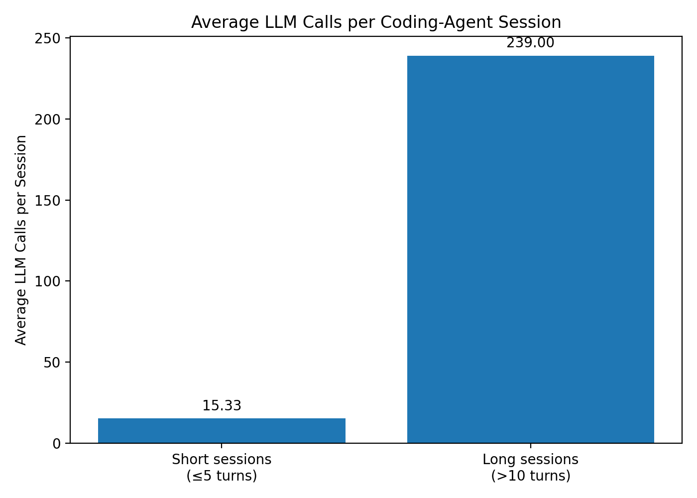

# AI Coding Agent Product Analytics

SQL product analysis of public GitHub Copilot coding-agent traces to understand how session complexity relates to model usage, latency, and reliability.

## Product Question

How do longer AI coding-agent sessions differ from shorter sessions in model usage, latency, and successful execution, and where might the product be optimized?

## Dataset

This project uses the public **GitHub Copilot Coding Agent Traces 2026** dataset.

I analyzed:

- **500 coding-agent sessions** for session-length behavior
- a **100-session sample** for deeper LLM-call analysis

The deeper analysis uses a 100-session sample because flattening the full nested trace structure exceeded the available local memory.

## Tools

- SQL
- DuckDB
- JSONL
- GitHub Copilot Coding Agent Traces

## Analysis

I first created a session-level view to measure:

- average session length
- median session length
- percentage of one-turn sessions
- percentage of sessions exceeding 5 and 10 turns
- share of total turn volume generated by long sessions

I then flattened nested turn and LLM-call data and compared:

- average LLM-call duration
- LLM calls per session
- call-level success rate
- result distributions

For the comparison:

- **Short sessions:** 5 turns or fewer
- **Long sessions:** more than 10 turns

## Key Findings

### 1. Most sessions are very short

Across the 500-session analysis:

- average session length: **3.378 turns**
- median session length: **1 turn**
- **54.4%** of sessions contained exactly 1 turn
- **16.6%** contained more than 5 turns
- **6.2%** contained more than 10 turns
- maximum observed session length: **54 turns**

This indicates a strongly right-skewed session-length distribution.

### 2. A small group of long sessions generates substantial interaction volume

Although only **6.2%** of sessions exceeded 10 turns, those sessions generated **36.23% of all turns**.

This suggests that a relatively small segment of complex sessions accounts for a disproportionate share of agent interaction.

### 3. Long sessions require substantially more model activity

In the 100-session LLM-call sample:

- short sessions averaged **15.33 LLM calls per session**
- long sessions averaged **239 LLM calls per session**

Long sessions therefore generated approximately **15.6x more LLM calls per session** than short sessions.

## Visualization



*Long-session vs short-session LLM-call comparison based on the 100-session nested-call sample.*

### 4. Long-session LLM calls were slower

Average LLM-call duration was approximately:

- **9.15 seconds** for short sessions
- **10.75 seconds** for long sessions

LLM calls associated with long sessions were therefore about **17.5% slower on average** in the sample.

### 5. Reliability remained high

Despite their larger model-call volume and higher average latency, long-session LLM calls maintained a high call-level success rate:

- short-session calls: approximately **97.6% success**
- long-session calls: approximately **99.6% success**

This suggests that the main opportunity is not necessarily improving reliability. Instead, the stronger opportunity appears to be improving **efficiency within complex sessions**.

## Product Recommendation

Optimize long coding-agent sessions by identifying and reducing repeated or unnecessary LLM calls.

The goal would be to lower model-call volume and latency while preserving the high success rate observed in complex sessions.

Potential areas for investigation include:

- repeated model calls within the same workflow
- inefficient tool/model orchestration
- opportunities to reuse prior context or intermediate results
- clearer detection of workflows that are becoming unusually expensive or long-running

## Success Metrics

### Primary Metric

**Average LLM calls per long session**

A successful optimization should reduce the number of model calls required to complete complex sessions.

### Secondary Metric

**Average LLM-call duration for long sessions**

This measures whether the experience becomes faster in addition to requiring fewer calls.

### Guardrail Metric

**Long-session success rate**

Efficiency improvements should not materially reduce successful execution.

## Product Takeaway

The analysis suggests that long coding-agent sessions are not primarily a reliability problem.

They appear to be an **efficiency problem**: a small percentage of sessions generates a disproportionately large amount of interaction and model activity while still completing successfully at a high rate.

Rather than encouraging shorter sessions or reducing model capability, I would focus on making complex sessions more efficient while protecting their existing reliability.

## Repository Structure

```text
AI-Coding-Agent-Product-Analytics/
├── README.md
├── analysis.sql
├── make_chart.py
└── llm_calls_short_vs_long.png